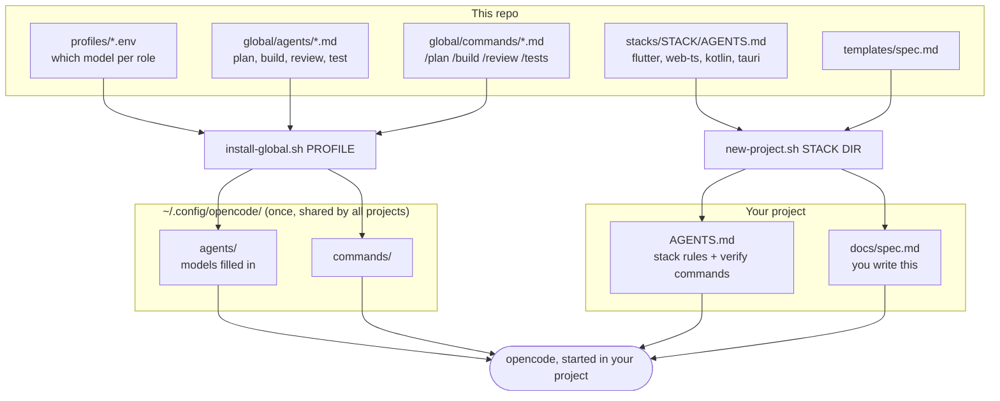
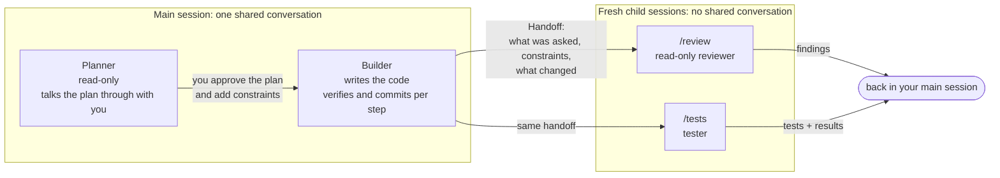

# opencode-workflow

A small, reusable setup for working with AI in [opencode](https://opencode.ai): four role agents
(planner, builder, reviewer, tester), each on a different model, plus one short rules file per tech stack
and one spec per project. No mega-prompt, no plan files.

- **Different models per role**, so the reviewer does not share the writer's blind spots.
- **Free-tier friendly**: swap the whole model lineup with one command when a quota runs out.
- **Stack-agnostic agents**: what changes per technology (Flutter, Next.js/Astro, Kotlin, Tauri) is one `AGENTS.md`.
- **Clean-context review and tests**: they run in fresh sessions that never saw the builder's reasoning.

## How it works

There are three kinds of things, created at three different moments:

| Layer | What it is | Where it ends up | When |
|---|---|---|---|
| **Profile** | Which model plays which role | Baked into the agents | Once, and again when you rotate models |
| **Global agents + commands** | The four roles and their slash commands | `~/.config/opencode/` (shared by every project) | Once |
| **Stack rules + spec** | How to work in this technology, and what this project is | Your project (`AGENTS.md`, `docs/spec.md`) | When you create a project |

### What depends on what



Read it top to bottom: the profile decides the models, `install-global.sh` bakes them into the agents, and when you
start opencode in a project it combines the global agents with that project's own `AGENTS.md` and spec.

### What happens when you work



- The **planner and builder share a conversation on purpose**: the builder needs the plan you just adjusted.
- The **reviewer and tester do not**. They only get your handoff text, the git history, the spec and the code, so they
  judge the code instead of agreeing with the builder's reasoning.
- Each role uses the model set in your profile, ideally from different model families.

### What to edit, and what it affects

| If you change... | It affects... | Then |
|---|---|---|
| `profiles/*.env` | The model each role uses, in every project | `./install-global.sh PROFILE` |
| `global/agents/*.md` | How each role behaves, in every project | `./install-global.sh` |
| `global/commands/*.md` | The slash commands | `./install-global.sh` |
| `stacks/STACK/AGENTS.md` | **Future** projects of that stack | Nothing for old ones: stacks are *copied* into projects, not linked |
| `AGENTS.md` inside a project | Only that project | Nothing |
| `docs/spec.md` inside a project | Only that project | Nothing |

## Quick start

Requirements: opencode, git, bash, and at least one model provider configured in opencode.

**Platform support:** developed and tested on Linux only. The scripts are plain bash and use
`~/.config/opencode/`, the Linux (XDG) location, so they should also work on macOS, but that is untested.
On Windows, use WSL. The agents, commands, `AGENTS.md` files and specs are just markdown and do not depend on the OS;
if you are on native Windows you can copy them by hand (replace the `@@..._MODEL@@` placeholders yourself) into the
config folder your opencode version uses. The verify commands in each stack are the same on every OS.
 
**Platform support:** the two scripts were only run on Linux. They are plain bash (`sed`, `mktemp`, `cmp`), so macOS
should work but is untested. On Windows, use WSL; the scripts do not run in native Windows shells. The agents, commands
and `AGENTS.md` files are plain Markdown and not OS-specific, so on any OS you can install them by hand: replace the
`@@..._MODEL@@` placeholders with real model IDs and copy the files to your opencode config directory (check the
opencode docs for where that is on your system). Some verify commands in `stacks/` are written for Unix shells
(for example `./gradlew`); adjust them if you work natively on Windows.

```bash
git clone https://github.com/YOUR_USER/opencode-workflow && cd opencode-workflow
chmod +x *.sh

./install-global.sh --list          # list profiles (* = active)
./install-global.sh                 # default profile: mixed-free

./new-project.sh flutter ~/code/my-app
cd ~/code/my-app && git init        # the builder commits, so it needs a repo
```

Then, in the new project:

1. Fill in the "Project-specific" block of `AGENTS.md` (state management, routing, backend... short facts only).
2. Write `docs/spec.md`: goal, v1 scope, what is out of scope, technical decisions already made.
3. Run `opencode`.

Existing agent/command files with different content are backed up as `*.bak.<timestamp>`.
Your `opencode.json` / `opencode.jsonc` are never touched.

## The flow

1. **Plan, in chat.** `Tab` to the planner (or `/plan <goal>`). Say what you want. It reads the code, asks what it
   needs, and presents a plan in the chat. Ask for changes until you like it. It writes no files.
2. **Build.** `Tab` to the builder and give your constraints, or `/build <constraints>`, e.g.
   `/build no new dependencies, use Riverpod, do not touch auth`. It works from the plan in the conversation plus
   your constraints, runs the verify commands from `AGENTS.md`, and commits each step. It never pushes.
3. **Review.** `/review <what was asked + constraints>`. Fresh background session, different model.
4. **Tests.** `/tests <what was asked + what to cover>`. Fresh background session, a third model. It writes tests from
   the intended behavior, the spec and the public interfaces, not from what the implementation happens to do.

The builder ends with a short handoff (what was asked, constraints, what changed). Paste it as the argument of
`/review` and `/tests`, since those sessions cannot see the conversation.

Prefer simplicity over isolation? You can also `Tab` to the reviewer and tester in the same session. You keep the
model diversity and lose the context isolation.

## Folder reference

```
opencode-workflow/
├── profiles/            which model plays which role
├── global/
│   ├── agents/          plan, build, review, test   -> ~/.config/opencode/agents/
│   └── commands/        /plan /build /review /tests -> ~/.config/opencode/commands/
├── stacks/              flutter, web-ts, kotlin, tauri: one AGENTS.md each
├── templates/           spec.md for new projects
├── install-global.sh    installs global/ with a profile's models filled in
└── new-project.sh       copies a stack AGENTS.md + the spec template into a project
```

**Why both `AGENTS.md` and a spec?** They answer different questions.
`AGENTS.md` says *how to work in this technology* (verify commands, conventions, pitfalls) and rarely changes.
`docs/spec.md` says *what this particular project is* and changes per project. The Flutter rules know to run
`flutter analyze`; only the spec tells the planner whether the app is a CRM or a fitness tracker.

**Why are models filled in by a script?** The agent files contain placeholders (`@@PLAN_MODEL@@`, ...) and
`install-global.sh` replaces them from the chosen profile. Switching models is one command instead of editing four files.

## Profiles (rotating free tiers)

Each profile is a tiny file with four lines:

```bash
PLAN_MODEL=provider/model
BUILD_MODEL=provider/model
REVIEW_MODEL=provider/model
TEST_MODEL=provider/model
```

| Profile | Idea |
|---|---|
| `mixed-free` (default) | Spreads roles across free quota pools; builder, reviewer and tester are different model families |
| `gemini-only` | Only the Gemini API free tier. Loses model diversity |
| `zen-only` | Only OpenCode free models, three families |
| `offline` | A local 1.5B model through ollama. Too small for reliable planning or tool calls; last resort only |
| `openai.env.example` | Template: copy to `profiles/openai.env`, fill in IDs from `opencode models openai` |

When a quota runs out: `./install-global.sh gemini-only`, then restart opencode. Nothing detects a dry quota for you.

The shipped model IDs reflect what was available when this was written. Free tiers and model names change often, so
check `opencode models` and your provider's current limits. Some free models may log or train on your prompts;
do not use those for private code.

## Optional: Context7

The builder prompt requires looking up current library docs through the `context7-mcp` skill before writing code that
touches third-party APIs. Install it once:

```bash
opencode plugin add @upstash/context7-opencode
opencode mcp auth context7
```

If you do not use Context7, delete the "Library documentation (mandatory)" section in `global/agents/build.md` and
the `context7-mcp` skill rule in the four agents, then re-run `./install-global.sh`.

If the builder still skips it, replace that section with:

> Before any edit or write that touches library imports, call context7-mcp first.

## Adding a stack or tuning one

- New stack: create `stacks/<name>/AGENTS.md` with a `## Verify` section (the exact commands), conventions, and a
  `## Lessons` section. `new-project.sh <name> <dir>` picks it up automatically.
- When an agent fails the same way twice, add one line to the `## Lessons` of that stack. Every future project gets it.
- Start with one stack, use it on two real projects, then open the others.

## Check before trusting (5 minutes)

Built against the OpenCode V2 docs (`agents`, `permissions` as a rule list, `subagent` on commands).
Run `opencode --version` first. If you are on V1, the agent permission syntax and command fields differ.

1. `opencode`, press `Tab`: `plan` and `build` show the models from your profile.
2. Ask `plan` to create or edit any file: it must refuse.
3. Run `/review` after a build: it must run as a background child session and state which intent it assumed
   (it cannot see the conversation). If it does see the conversation, set `subagent: false` in the commands and start a
   new session (`/new`) before reviewing or testing.
4. Ask `review` to edit a file: it must refuse.
5. Give the builder a task that uses a library: it should call `context7-mcp` before writing code.
6. Background sessions may handle permission prompts differently. If a prompt gets stuck in `/review` or `/tests`,
   switch those commands to `subagent: false`.
7. `review` and `test` are defined with `mode: all`. Check whether they also show up when you press `Tab`.

Personal cross-project rules (a few lines, e.g. "ask before adding dependencies") go in
`~/.config/opencode/AGENTS.md`. Check that it loads next to a project `AGENTS.md` by asking an agent to recite its
rules; there is a GitHub issue reporting it being ignored in some versions.